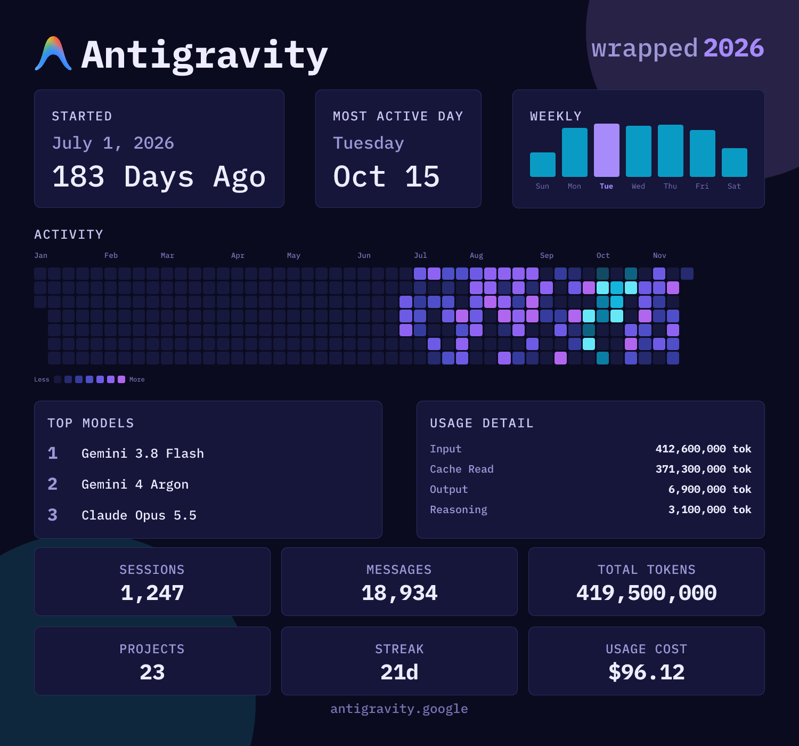

<div align="center">

# agy-wrapped

**Your year in code, beautifully visualized.**

<p>
  <strong>Credit:</strong> Modified from
  <a href="https://github.com/numman-ali/codex-wrapped">numman-ali/codex-wrapped</a>,
  which was built on top of
  <a href="https://github.com/moddi3/opencode-wrapped">opencode-wrapped</a>.
  Antigravity model mappings informed by
  <a href="https://github.com/ccusage/ccusage">ccusage</a>.
</p>

Generate a personalized "Spotify Wrapped"-style summary of your
[Google Antigravity](https://antigravity.google) usage.

[](LICENSE)
[](https://bun.sh)



</div>

---

Not affiliated with or endorsed by Google.

## Installation

### Quick Start

Run directly without installing:

```bash
npx agy-wrapped # or bunx, or yarn/pnpm dlx
```

### Global Install

```bash
npm install -g agy-wrapped # or bun/yarn/pnpm
```

Then run anywhere:

```bash
agy-wrapped
```

## Usage Options

| Option          | Description                                        |
| --------------- | -------------------------------------------------- |
| `--year, -y`    | Generate wrapped for a specific year               |
| `--web, -w`     | Open the interactive dashboard instead of the card |
| `--help, -h`    | Show help message                                  |
| `--version, -v` | Show version number                                |

Set `ANTIGRAVITY_DATA_DIR` (comma-separated) to read data directories other than the defaults below.

## Features

- Sessions, messages, tokens, projects, and streaks
- GitHub-style activity heatmap
- Top models breakdown (Gemini, Claude, and GPT-OSS models in Antigravity)
- Estimated cost at API list prices
- Shareable PNG image
- Inline image display (Ghostty, Kitty, iTerm2, WezTerm, Konsole)
- Auto-copy to clipboard

## Terminal Support

The wrapped image displays natively in terminals that support inline images:

| Terminal                                   | Protocol       | Status                      |
| ------------------------------------------ | -------------- | --------------------------- |
| [Ghostty](https://ghostty.org)             | Kitty Graphics | Full support                |
| [Kitty](https://sw.kovidgoyal.net/kitty/)  | Kitty Graphics | Full support                |
| [WezTerm](https://wezfurlong.org/wezterm/) | Kitty + iTerm2 | Full support                |
| [iTerm2](https://iterm2.com)               | iTerm2 Inline  | Full support                |
| [Konsole](https://konsole.kde.org)         | Kitty Graphics | Full support                |
| Other terminals                            | —              | Image saved to file only    |

## Output

The tool generates:

1. **Terminal Summary** — Quick stats overview in your terminal
2. **PNG Image** — A beautiful, shareable wrapped card saved to your home directory
3. **Clipboard** — Automatically copies the image to your clipboard

### Interactive dashboard

`npx agy-wrapped --web` writes a single self-contained HTML file to your temp folder and opens it. It works offline and loads nothing from the internet. Click a day, week, model or project to filter everything else; shift-click days to pick a range; click a conversation to see its per-model breakdown. Filters are kept in the URL, so a reload keeps your view.

The page shows activity by day and week, models with token and cost breakdowns, workspaces, conversations with their Antigravity titles, tools the agent called, and when in the week you work. "Prompts" are messages you typed; "requests" are model responses.

## Data Source

`agy-wrapped` reads Antigravity's local conversation databases:

```
~/.gemini/antigravity/conversations/*.db
~/.gemini/antigravity-cli/conversations/*.db
~/.gemini/antigravity-ide/conversations/*.db
~/.gemini/antigravity-backup/conversations/*.db
~/.gemini/antigravity-acp/conversations/*.db
~/.config/antigravity/conversations/*.db
```

Each database records per-request token usage (input, cache reads and writes, output, and
thinking). Requests recorded more than once, including copies of a conversation in several of
these folders, are counted once.

Older Antigravity versions stored conversations as encrypted `.pb` files. Those can't be read,
so they are left out; the tool tells you how many were skipped.

No data is sent anywhere. Everything is processed locally.

## Cost Estimates

Antigravity is billed by plan, not per token. The usage cost shown is what the same tokens would
cost at each provider's API list prices, using the price in effect on the day of each request
(several Gemini launch prices double later). Prices are versioned in:

```
src/pricing-data.ts
```

Antigravity's internal model names (effort variants like `gemini-4-carbon-high`, rollout tags like
`gemini-4-argon-trial`, numeric placeholder IDs, and older aliases like `gemini-3-flash-agent-a`)
are mapped to their public models in `src/antigravity-models.ts`. Models without a known price
are still counted in tokens and listed as unpriced.

## Building

### Development

```bash
# Run in development mode with hot reload
bun run dev
```

### Production Build

```bash
# Build for all platforms
bun run build
```

### Releasing

```bash
bun run scripts/publish.ts <version>
```

## Tech Stack

- **Runtime**: [Bun](https://bun.sh) (including `bun:sqlite`)
- **Image Generation**: [Satori](https://github.com/vercel/satori) + [Resvg](https://github.com/nicolo-ribaudo/resvg-js)
- **CLI UI**: [@clack/prompts](https://github.com/natemoo-re/clack)
- **Font**: IBM Plex Mono

## Contributing

Contributions are welcome! Please feel free to submit a Pull Request.

## License

MIT License - see [LICENSE](LICENSE) for details.
